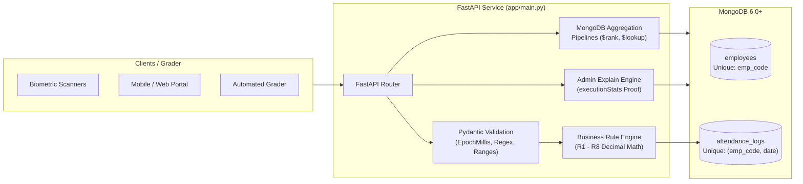

<div align="center">

# ⏱️ Employee Attendance & Analytics API

**Production-grade FastAPI backend service for enterprise attendance tracking, audit regularization, and MongoDB aggregation analytics.**

[](https://www.python.org/)
[](https://fastapi.tiangolo.com/)
[](https://www.mongodb.com/)
[](openapi.yaml)
[](test_runner.py)

[Features](#-key-features) • [Quick Start](#-quick-start) • [Architecture](#-architecture) • [API Reference](#-api-reference) • [Business Rules](#-business-rules-r1r10) • [Testing](#-testing--verification)

</div>

---

## 🚀 Overview

This service implements the complete backend of a robust HR attendance management system. It allows employees to punch in/out across normal and overnight shifts, enables managers to regularize records with tamper-proof audit trails, and provides real-time departmental intelligence via database-level MongoDB aggregation pipelines.

Built strictly according to the **Candidate Kit Contract**, all production code is self-contained within [`app/main.py`](app/main.py) and ready for automated grader evaluation.

---

## ✨ Key Features

* **⚡ Single-File Architecture**: Clean, modular structure encapsulated entirely inside [`app/main.py`](app/main.py).
* **🛡️ Race-Safe Concurrency**: 
  * Unique compound database index on `(emp_code, date)` guarantees that concurrent punch-ins produce exactly one `201 Created` and all others `409 Conflict`.
  * Atomic `find_one_and_update` on open records (`punch_out: None`) prevents double-close races.
  * Optimistic version-checking on `PATCH` ensures concurrent regularizations never overwrite audit history.
* **🕒 Precision Time & Boundary Handling**:
  * All HTTP instants are integer **epoch milliseconds** with whole-second truncation (R1).
  * Shift times and calendar dates are strings in **IST (UTC+05:30)**.
  * Internal MongoDB `_id` is stripped from every request and response.
* **📊 Pure MongoDB Aggregation Pipelines**:
  * **Department Summary**: Preserves eligible employees with zero attendance logs in headcount (R9).
  * **Late Leaderboard**: Standard competition ranking (`1, 2, 2, 4`) using `$setWindowFields` and `$rank`, applying `limit` after ranking.
  * **Daily Trend**: Daily series with gap filling and 7-calendar-day moving average calculated in the database.
* **🔍 Operational Proof (`/admin/explain`)**:
  * Real-time `executionStats` verification demonstrating index scans (`IXSCAN`) and **zero collection scans (`COLLSCAN`)**.

---

## 🏗️ Architecture



---

## ⚡ Quick Start

### 1. Prerequisites
* **Python**: 3.11 or newer
* **MongoDB**: 6.0 or newer (Atlas Free Tier M0 or local MongoDB service)

### 2. Installation
Clone the repository and install the dependencies:
```bash
pip install -r requirements.txt
```

### 3. Environment Configuration
Set `MONGO_URI` and `MONGO_DB` via environment variables or a local `.env` file:
```env
MONGO_URI=mongodb+srv://<username>:<password>@<cluster>.mongodb.net/?retryWrites=true&w=majority
MONGO_DB=attendance_db
```
> [!NOTE]
> System environment variables always take precedence over the `.env` file. Do not commit `.env` or credentials to git.

### 4. (Optional) Seed Sample Documents
Load the 9 initial sample records into your MongoDB database:
```bash
python sample_seed.py
```

### 5. Start the Application
Boot the server using the exact contract command:
```bash
uvicorn app.main:app --port 8000 --reload
```
> [!TIP]
> Database indexes are created **automatically and idempotently** during application startup.

---

## 📖 Interactive API Documentation

Once started, open your browser to access the interactive Swagger UI and test endpoints directly:
* **Interactive Swagger UI**: [http://localhost:8000/docs](http://localhost:8000/docs)
* **ReDoc Specification**: [http://localhost:8000/redoc](http://localhost:8000/redoc)

---

## 📡 API Reference

| Method | Endpoint | Description | Status Codes |
| :--- | :--- | :--- | :--- |
| **GET** | `/health` | Readiness probe; pings MongoDB cluster | `200`, `503` |
| **POST** | `/employees` | Create employee; client-supplied unique `emp_code` | `201`, `409`, `422` |
| **GET** | `/employees` | List employees sorted by `emp_code` ASC; paginated | `200`, `422` |
| **POST** | `/attendance/punch-in` | Creates day's record (R1, R2); race-safe compound index | `201`, `404`, `409`, `422` |
| **POST** | `/attendance/punch-out` | Closes latest open record; computes hours, OT & half-day | `200`, `404`, `409`, `422` |
| **GET** | `/attendance` | List attendance records; sorted by date DESC, emp_code ASC | `200`, `422` |
| **PATCH** | `/attendance/{emp_code}/{date}` | Regularize record; recomputes metrics and appends audit log | `200`, `404`, `409`, `422` |
| **GET** | `/analytics/employees/{emp_code}/monthly` | Monthly employee summary; dynamic working days & presence | `200`, `404`, `422` |
| **GET** | `/analytics/departments/summary` | Department summary; preserves zero-log headcount (R9) | `200`, `422` |
| **GET** | `/analytics/leaderboard/late` | Late leaderboard ranking with ties (1, 2, 2, 4); limit post-rank | `200`, `422` |
| **GET** | `/analytics/departments/{department}/trend` | Daily trend series with gap filling and 7-day moving average | `200`, `404`, `422` |
| **GET** | `/admin/explain/{endpoint}` | MongoDB `executionStats` raw output proving index scans | `200`, `422` |

---

## 📏 Business Rules (R1–R10)

* **R1 — Timezone & Attendance Date**: Shift times and attendance dates are in IST (UTC+05:30). Instants are truncated to whole seconds. Overnight shifts (`shift_end <= shift_start`): punch-ins before `shift_end` belong to the previous day's shift date.
* **R2 — Late Calculation**: 10-minute grace period. Late only if strictly $> 10:00$ after `shift_start`; then `late_minutes = floor(elapsed / 60)` from `shift_start` (not from grace end).
* **R3 — Overtime**: Floored minutes from `shift_end` to `punch_out`, counted only if $\ge 30$; otherwise 0.
* **R4 — Work Hours**: `(punch_out - punch_in) / 3600`, rounded half-up to 2 decimals using `Decimal(ROUND_HALF_UP)`.
* **R5 — Half Day**: `half_day = true` when rounded `work_hours < 4.50`. Counts as 0.5 of a present day.
* **R6 — Presence**: `PRESENT`, `WFH`, and `ON_DUTY` count as present; `ABSENT` and `LEAVE` do not.
* **R7 — Working Days**: Mon–Fri working days counted from `joined_on` for mid-month joiners. `present_days` only counts Mon–Fri records.
* **R8 — Rounding**: Quantities/hours rounded to 2 decimals half-up; rates to 4 decimals half-up.
* **R9 — Headcount**: Includes all employees with `joined_on <= period_end`, even with zero logs.
* **R10 — Pagination**: 1-indexed (`skip = (page - 1) * page_size`), default 20, max 100.

---

## 🧪 Testing & Verification

Run the automated test suites from the project root:

```bash
# 1. Full API test suite across all 12 endpoints
python test_runner.py

# 2. Edge-case test suite (ties, overnight shifts, mid-month joiners, grace limits)
python test_edge_cases.py
```

### Automated Verification Highlights:
- ✅ **100% Endpoint Pass**: All endpoints validate exact status codes and contract schemas.
- ✅ **Boundary Precision**: Confirmed exact boundaries for grace period (`09:40:00` $\rightarrow 0$, `09:40:01` $\rightarrow 10$) and overtime ($29$m $\rightarrow 0$, $30$m $\rightarrow 30$).
- ✅ **Leaderboard Ties**: Confirmed Standard Competition Ranking (`1, 1, 3`) and verified `limit=1` preserves both tied candidates.
- ✅ **IXSCAN Verified**: All `/admin/explain` diagnostic endpoints verified executing `IXSCAN` with zero `COLLSCAN`.

---

## 📁 Repository Deliverables

```text
├── app/
│   ├── __init__.py          # Package marker
│   └── main.py              # Complete FastAPI application (all endpoints & models)
├── sample_data/             # Nine sample documents in MongoDB Extended JSON
├── sample_seed.py           # Loader script for sample documents
├── test_runner.py           # Full automated test suite for all endpoints
├── test_edge_cases.py       # Domain edge-case test suite
├── REVIEW.md                # Starter code audit: 10+ defects, symptoms, and fixes
├── DECISIONS.md             # Architectural design decisions (190 words)
├── requirements.txt         # Pinned runtime dependencies
├── README.md                # Project documentation
└── .gitignore               # Protects .env, caches, and secrets
```

---

<div align="center">
Developed for the HROne Software Engineer Assessment.
</div>
