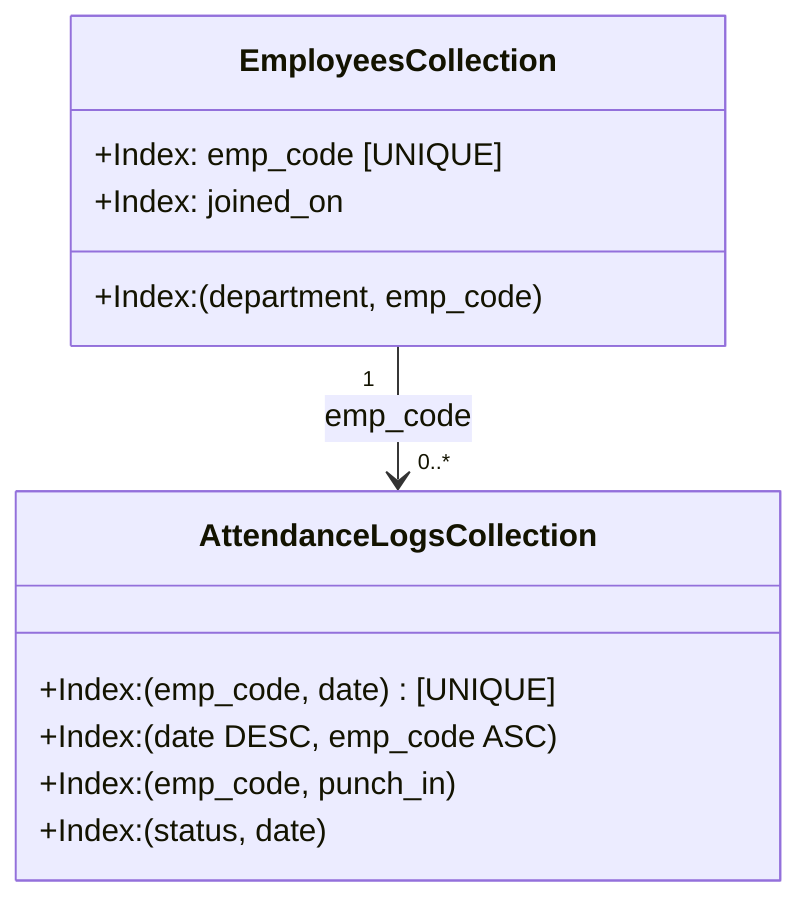
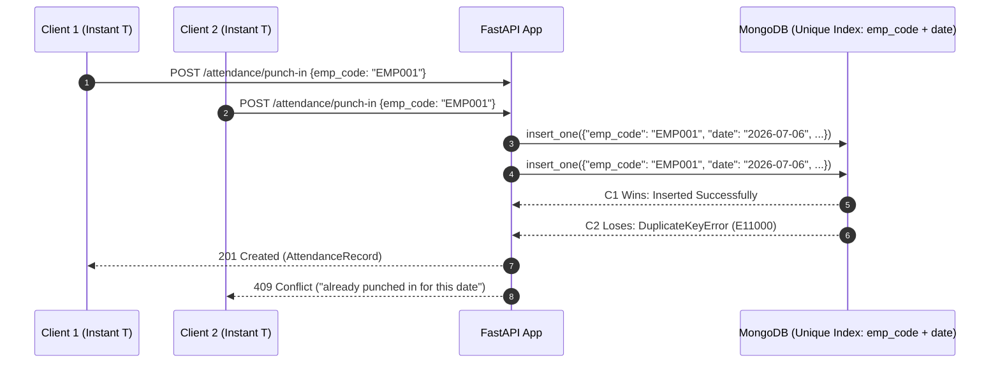
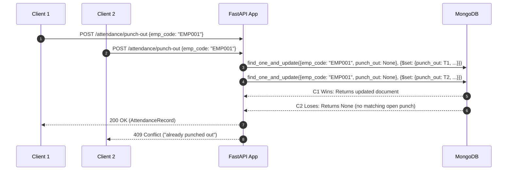

# Technical Architecture & Design Document
## HROne — Employee Attendance & Analytics API

---

## 1. Executive Summary & Constraints

This document defines the complete **High-Level Design (HLD)**, **Low-Level Design (LLD)**, **Database Architecture**, and **API Specifications** for the HROne Employee Attendance & Analytics service.

### Strict System Constraints
1. **Single-File Architecture**: The assignment contract mandates that all production code, helpers, models, and routes reside strictly within `app/main.py`. It boots via `uvicorn app.main:app --port 8000`.
2. **Runtime & Drivers**: Python 3.11+, FastAPI, PyMongo (synchronous driver, consistent and race-safe), and MongoDB 6.0+ (tested on MongoDB 7.0).
3. **Network Boundary**: Zero external network access allowed. Only communication with MongoDB is permitted.
4. **Time & Instant Boundary**:
   - **Instants**: Transmitted via HTTP as integer **epoch milliseconds** (`minimum: 100000000000`). Truncated to whole seconds prior to any business calculation and persistence. Stored in MongoDB as **BSON datetimes (UTC)**.
   - **Calendar Dates & Times**: Plain strings in **IST (UTC+05:30)**: dates as `"YYYY-MM-DD"`, months as `"YYYY-MM"`, and shifts as `"HH:MM"`.
   - **Internal Identifiers**: MongoDB `_id` is internal only and strictly excluded from all API requests and responses. Attendance records have no independent ID and are addressed by the natural key `(emp_code, date)`.

---

## 2. High-Level Design (HLD)

### 2.1 System Architecture

```mermaid
flowchart TD
    subgraph ClientLayer["Client / Automated Grader"]
        Client["HTTP Client / Test Runner"]
    end

    subgraph ServiceLayer["FastAPI Application (app/main.py)"]
        Router["FastAPI HTTP Router\n(Exact OpenAPI Paths)"]
        Validation["Pydantic v2 Request Validation\n(EpochMillis, Regex, Range Checks)"]
        
        subgraph CoreEngine["Domain & Rules Engine (R1–R10)"]
            TimeHelper["IST / Epoch ms / Second Truncation"]
            ShiftResolver["Overnight Shift & Date Resolver (R1)"]
            MetricEngine["Late (R2), Overtime (R3), Work Hours (R4), Half Day (R5)"]
            HistoryEngine["Audit Trail Delta Builder (History)"]
        end

        subgraph AggregationEngine["MongoDB Analytics Pipelines"]
            MonthlyPipe["Employee Monthly Aggregation"]
            DeptSummaryPipe["Cross-Collection Dept Summary (Preserves 0-log employees)"]
            LeaderboardPipe["Late Leaderboard ($setWindowFields / $rank ties)"]
            TrendPipe["Dept Daily Trend ($densify & 7-day Moving Avg)"]
        end

        AdminExplain["/admin/explain Engine\n(executionStats, IXSCAN proof)"]
    end

    subgraph DatabaseLayer["MongoDB 6.0+"]
        EmpCol[("employees Collection\nUnique: emp_code")]
        AttCol[("attendance_logs Collection\nUnique: (emp_code, date)")]
    end

    Client -->|HTTP REST| Router
    Router --> Validation
    Validation --> CoreEngine
    CoreEngine -->|Atomic CRUD / Writes| DatabaseLayer
    Router --> AggregationEngine
    AggregationEngine -->|Aggregation Pipelines| DatabaseLayer
    Router --> AdminExplain
    AdminExplain -->|explain(executionStats)| DatabaseLayer
```

### 2.2 Layered Responsibilities Inside Single-File `app/main.py`

Even though the application is contained within a single file, it is structured into clear logical layers:

```
┌─────────────────────────────────────────────────────────────┐
│ 1. Configuration & MongoDB Client Lifecycle (Lifespan)      │
│    - Reads MONGO_URI, MONGO_DB (env overrides .env)         │
│    - Idempotent index creation on startup                   │
├─────────────────────────────────────────────────────────────┤
│ 2. Data Boundary & Conversion Helpers                       │
│    - Epoch ms <-> BSON UTC datetime (whole-second truncate) │
│    - IST datetime arithmetic & overnight shift calendar math │
├─────────────────────────────────────────────────────────────┤
│ 3. Precision Rules Engine (R1 - R8)                         │
│    - compute_late_minutes (10m grace, floored from start)   │
│    - compute_work_hours (Decimal ROUND_HALF_UP)             │
│    - compute_overtime_minutes (>= 30m threshold, next day)  │
│    - is_half_day (< 4.50h -> 0.5 present day)               │
├─────────────────────────────────────────────────────────────┤
│ 4. Pydantic v2 Schemas & Response Serializers               │
│    - Request DTOs with strict boundary validators           │
│    - Safe Mongo doc to JSON mapper (removes _id)            │
├─────────────────────────────────────────────────────────────┤
│ 5. Transactional / Attendance Endpoints                     │
│    - /health (Mongo ping check)                             │
│    - /employees (Create with unique index, list paginated)  │
│    - /attendance/punch-in (Race-safe compound unique insert)│
│    - /attendance/punch-out (Atomic find_one_and_update)     │
│    - /attendance (DB-level sort, filter, pagination)        │
│    - PATCH /attendance/{emp_code}/{date} (Audit log update) │
├─────────────────────────────────────────────────────────────┤
│ 6. Analytics Aggregation Pipelines                          │
│    - /analytics/employees/{emp_code}/monthly                │
│    - /analytics/departments/summary                         │
│    - /analytics/leaderboard/late                            │
│    - /analytics/departments/{department}/trend             │
├─────────────────────────────────────────────────────────────┤
│ 7. Operational Proof Endpoint                               │
│    - /admin/explain/{endpoint} (executionStats validator)   │
└─────────────────────────────────────────────────────────────┘
```

---

## 3. Database Design

### 3.1 Collections & Schema Specifications

The database contains two collections seeded by the grader: `employees` and `attendance_logs`.

#### Collection: `employees`

| Field | MongoDB BSON Type | API Representation | Constraints & Rules |
| :--- | :--- | :--- | :--- |
| `_id` | `ObjectId` | *Never exposed* | MongoDB internal identifier. |
| `emp_code` | `string` | `string` | Unique customer code (format: `EMP\d{4,6}`). Immutable business key. |
| `name` | `string` | `string` | 1–100 characters. |
| `email` | `string` | `string` | Valid email pattern, max 120 characters. |
| `department` | `string` | `string` | Case-sensitive, 1–50 characters. |
| `shift_start` | `string` | `string` | `"HH:MM"` 24-hr IST. Default `"09:30"`. |
| `shift_end` | `string` | `string` | `"HH:MM"` 24-hr IST. Default `"18:30"`. If `shift_end <= shift_start`, overnight shift. |
| `joined_on` | `string` | `string` | `"YYYY-MM-DD"` IST calendar date. |
| `created_at` | `BSON date` | `int64` (epoch ms) | Server-generated timestamp. |

#### Collection: `attendance_logs`

| Field | MongoDB BSON Type | API Representation | Constraints & Rules |
| :--- | :--- | :--- | :--- |
| `_id` | `ObjectId` | *Never exposed* | Internal identifier. No external ID exposed. |
| `emp_code` | `string` | `string` | Foreign key referencing `employees.emp_code`. |
| `date` | `string` | `string` | `"YYYY-MM-DD"` IST attendance date (R1). Natural key with `emp_code`. |
| `status` | `string` | `string` | Enum: `PRESENT`, `WFH`, `ON_DUTY`, `ABSENT`, `LEAVE`. Presence statuses require `punch_in`. |
| `punch_in` | `BSON date` / `null` | `int64` / `null` | Epoch ms, whole-second truncated. Null for `ABSENT`/`LEAVE`. |
| `punch_out` | `BSON date` / `null` | `int64` / `null` | Epoch ms, whole-second truncated. Null until employee punches out. |
| `work_hours` | `double` / `null` | `float` / `null` | Decimal half-up rounded (2 decimals). Null until punch-out. |
| `late_minutes`| `int` | `int` | Whole minutes floored (R2). Default 0. |
| `overtime_minutes`| `int` | `int` | Whole minutes floored if >= 30m (R3). Default 0. |
| `half_day` | `bool` | `bool` | True if `work_hours < 4.50` (R5). Missing in legacy records $\rightarrow$ `false`. |
| `history` | `array[object]` | `array[object]` | Audit trail of manual corrections only. Missing in legacy $\rightarrow$ `[]`. |

---

### 3.2 Index Strategy

To guarantee that queries stay fast on 100,000+ documents and pass `/admin/explain` with `IXSCAN` and **zero `COLLSCAN`**, the following indexes are created idempotently at startup:



1. **`employees.create_index([("emp_code", 1)], unique=True)`**:
   - *Purpose*: Enforces primary business identity uniqueness. Rejects concurrent duplicate employee creations with 409.
2. **`employees.create_index([("department", 1), ("emp_code", 1)])`**:
   - *Purpose*: Supports `GET /employees?department=...` with index-backed filtering and ascending sort without in-memory sort stages.
3. **`attendance_logs.create_index([("emp_code", 1), ("date", 1)], unique=True)`**:
   - *Purpose*: Enforces natural key uniqueness. Prevents race-condition duplicate punch-ins for the same attendance date. Optimizes employee-specific attendance lookups and regularizations.
4. **`attendance_logs.create_index([("date", -1), ("emp_code", 1)])`**:
   - *Purpose*: Directly satisfies `GET /attendance` default sorting (`date` DESC, `emp_code` ASC) and date range filters (`date_from`, `date_to`) via index scan.
5. **`attendance_logs.create_index([("emp_code", 1), ("punch_in", -1)])`**:
   - *Purpose*: Optimizes `POST /attendance/punch-out` finding the latest open punch-in (`punch_out: None`).

---

## 4. Low-Level Design (LLD) & Algorithm Details

### 4.1 Precision Helpers & Business Rules (R1–R10)

#### Rule R1 & R2: Second Truncation, Overnight Shift & Late Calculation
- **Second Truncation**: Truncate microsecond components before calculations and persistence.
- **Attendance Date Resolution**:
  - Normal shift date is IST date.
  - Overnight shift (`shift_end <= shift_start`): if punch-in IST time is earlier than `shift_end`, it belongs to the shift that started the previous calendar day.
- **Late Calculation**:
  - 10-minute grace period. Late only if strictly more than 10 minutes (`elapsed_seconds > 600`) after `shift_start`.
  - When late, `late_minutes = floor((punch_in - shift_start) / 60)`. Otherwise `0`.

#### Rule R3, R4 & R5: Work Hours, Overtime & Half Day
- **Work Hours**: `(punch_out - punch_in)` in seconds / 3600.
  - Must use `decimal.Decimal` with `ROUND_HALF_UP` to 2 decimal places.
- **Overtime**:
  - Whole minutes floored from `shift_end` to `punch_out`, counted only if `>= 30`; otherwise `0`.
  - For overnight shifts, `shift_end` is evaluated on `date + 1 day`.
- **Half Day**:
  - `half_day = true` when rounded `work_hours < 4.50`.
  - Counts as `0.5` of a present day.

---

### 4.2 Concurrency & Race-Condition Sequence Diagrams

#### Scenario 1: Two Simultaneous Punch-Ins for the Same Date
A unique compound index on `(emp_code, date)` guarantees atomicity at the database level:



#### Scenario 2: Two Simultaneous Punch-Outs
Using atomic `find_one_and_update` on an open record (`punch_out: None`):



---

## 5. Non-Trivial MongoDB Aggregation Pipelines

### 5.1 Department Summary Pipeline (`/analytics/departments/summary`)
- Starts from `employees` filtering `joined_on <= month_end` to ensure employees with **zero logs are counted** in `headcount`.
- Joins `attendance_logs` using `$lookup`.
- Computes `avg_work_hours` across qualifying records (not average of averages).

### 5.2 Late Leaderboard Pipeline (`/analytics/leaderboard/late`)
- Aggregates logs per employee for the month where `late_minutes > 0`.
- Implements standard competition ranking (`1, 2, 2, 4`) using `$setWindowFields` with `$rank`.
- Sorts tied employees by `emp_code` ascending.
- Applies `limit` **after** ranking (`rank <= limit`).

### 5.3 Department Daily Trend Pipeline (`/analytics/departments/{department}/trend`)
- Groups attendance by date.
- Uses `$densify` on calendar dates between `from` and `to` to produce exactly one row per day.
- Computes `attendance_rate` on working days with `headcount > 0`.
- Computes 7-day moving average using `$setWindowFields` over up to 6 preceding rows in the range.

---

## 6. Complete API Specifications

| Method | Exact Path | Request Payload | Response (Success) | Error Codes | Key Purpose |
| :--- | :--- | :--- | :--- | :--- | :--- |
| `GET` | `/health` | *None* | `200 {status: "ok"}` | `503` | MongoDB ping readiness probe |
| `POST` | `/employees` | `EmployeeCreate` JSON | `201 Employee` | `409, 422` | Create employee with unique `emp_code` |
| `GET` | `/employees` | `department?`, `page`, `page_size` | `200 EmployeePage` | `422` | Sorted by `emp_code` ascending, filtered count |
| `POST` | `/attendance/punch-in` | `PunchInRequest` JSON | `201 AttendanceRecord` | `404, 409, 422` | Create daily record, R1 date, R2 late |
| `POST` | `/attendance/punch-out` | `PunchOutRequest` JSON | `200 AttendanceRecord` | `404, 409, 422` | Closes latest open punch, computes R3–R5 |
| `GET` | `/attendance` | `emp_code?`, `date_from?`, `date_to?`, `status?`, `page`, `page_size` | `200 AttendancePage` | `422` | Sorted by `date` DESC, `emp_code` ASC |
| `PATCH`| `/attendance/{emp_code}/{date}` | `RegularizeRequest` JSON | `200 AttendanceRecord` | `404, 409, 422` | Regularize day record, appends audit `history` |
| `GET` | `/analytics/employees/{emp_code}/monthly` | `month` query (`YYYY-MM`) | `200 EmployeeMonthly` | `404, 422` | Employee monthly stats, R7 working days |
| `GET` | `/analytics/departments/summary` | `month`, `department?` | `200 DepartmentSummary`| `422` | Cross-collection summary, preserves 0-log |
| `GET` | `/analytics/leaderboard/late` | `month`, `limit?`, `department?` | `200 Leaderboard` | `422` | Tie-aware ranking ($rank), limit after rank |
| `GET` | `/analytics/departments/{department}/trend` | `from`, `to` queries | `200 Trend` | `404, 422` | Gap-filled daily series ($densify) + 7d MA |
| `GET` | `/admin/explain/{endpoint}` | Matching endpoint params | `200 ExplainResponse` | `422` | Returns raw `executionStats` (IXSCAN proof) |
